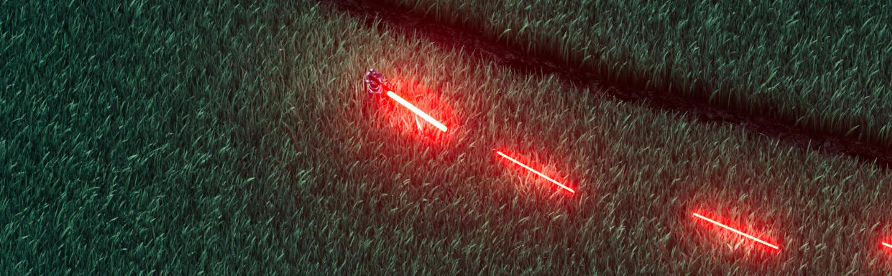

# HDR Blaster



A little top-down shooter built mostly as an excuse to test HDR and WebGPU compute shaders in browser.

**[Try it](https://tobiasmelen.github.io/hdr-blaster/)**

## Tech
It's just Vite using ThreeJS with new WebGPURenderer and TSL shaders. Incompatible with WebGL fallback due to compute shader use, a WebGPU compatible browser is required.

Running code should just be
```
npm install
npm run dev
```

## Inspiration

Grass rendering initially based on [SimonDev's](https://www.youtube.com/@simondev758) video on grass rendering. Very powerful blasters idea is from Unreal Tournament Instagib mode.
